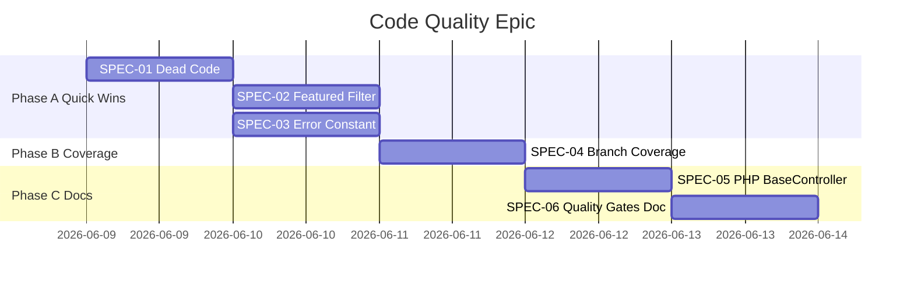

# Spec-Driven Plan: Code Quality Improvements

**Branch:** `feature/code-quality-improvements`  
**Stand:** 2026-06-08  
**Status:** Phase A–C abgeschlossen — PR/Merge ausstehend  
**Methode:** Fallow (`npx fallow`) + manuelle Codebase-Analyse + ADR/OpenAPI-Abgleich

---

## 1. Ziel & Nicht-Ziele

### Ziel

- Messbare Verbesserung von Lesbarkeit, Konsistenz und Wartbarkeit
- Fallow-Befunde auf 0 (dead files/exports)
- Branch-Coverage Frontend stabil ≥ 78 %
- Klare Konventionen für Fehlerbehandlung, Barrel-Exports und PHP-Controller-Basisklassen
- Keine funktionalen Regressionen (**310** Unit-Tests + E2E grün)

### Nicht-Ziele (dieser Plan)

- Neues `php-shared/`-Package (zu groß — nur dokumentieren als Future ADR)
- JWT / Auth-Umbau
- Python-API Sunset-Umfang erweitern
- Shared-Hosting-Deploy-Änderungen

---

## 2. Analyse-Ergebnisse

### 2.1 Ausgangslage (vor Epic)

| Check | Ergebnis (Start) |
|-------|------------------|
| `fallow dead-code` | 1 unused file, 2 unused type re-exports |
| `fallow dupes` (min 3) | Keine Duplikat-Cluster |
| `fallow health` | Score **100 A**, MI 92.0 |
| Coverage (Karma) | Statements 94.5 %, **Branches 75.4 %**, Functions 94.4 %, Lines 95.3 % |
| Unit-Tests | 290 |

### 2.2 Ist nach Epic (Verifikation 2026-06-08)

| Check | Ergebnis (aktuell) |
|-------|-------------------|
| `fallow dead-code` | **0** files, **0** type exports |
| `fallow dupes` (min 3) | Keine Duplikat-Cluster |
| `fallow health --fail-on-issues` | MI **92.0**, 0 above threshold |
| Coverage (Karma) | Statements **95.2 %**, Branches **78.4 %**, Functions **94.6 %**, Lines **96.0 %** |
| Unit-Tests | **310** SUCCESS |
| Karma `branches` threshold | **78 %** (war 74 %) |

**Noch optionale Branch-Lücken:** `project.mapper.ts` (~69 %), `tech-stack.mapper.ts` (~72 %) — nicht Epic-blockierend.

**Fallow Refactoring Targets (unverändert relevant bei Änderungen):**

| Datei | Grund | Fan-in |
|-------|-------|--------|
| `shared/utils/api-error.util.ts` | Hohe Kopplung, Fehler-Normalisierung zentral | 4 |
| `shared/models/load-status.model.ts` | Legacy-Fallback-Logik, viele Consumer | 10 |
| `state/knowledge/mappers/project.mapper.ts` | Komplexität + Fan-out | 6 fan-out |

### 2.3 Manuelle Befunde — Status

#### P1 — Inkonsistenz / Wartbarkeit

| ID | Befund | Status |
|----|--------|--------|
| Q-01 | Doppelte Featured-Filter-Logik | ✅ SPEC-02 |
| Q-02 | Doppelte Default-Fehlermeldung | ✅ SPEC-03 |
| Q-03 | Ungenutzter Core-Models-Barrel | ✅ SPEC-01 |
| Q-04 | Type-Re-Export-Leichen | ✅ SPEC-01 |
| Q-05 | PHP `BaseController`-Drift | ✅ SPEC-05 (dokumentiert) |
| Q-06 | Branch-Coverage knapp | ✅ SPEC-04 |
| Q-07 | NPM-Script-Naming | ✅ dokumentiert (siehe §2.4) |

#### P2 — DX / Repo-weit

| ID | Befund | Status |
|----|--------|--------|
| Q-08 | Fallow nur Frontend | ⏸️ Future Epic |
| Q-09 | `VITE_API_KEY` vs `API_KEY` | ✅ Root-README |
| Q-10 | Mailer ohne `ApiKeyResolver` | ⏸️ akzeptiert (ADR) |
| Q-11 | OpenAPI-Lint | ✅ Drone `openapi-lint` |
| Q-12 | Deploy-PS Logging | ⏸️ optional |

### 2.4 NPM-Script-Konvention (`:ci`-Suffix)

CI-taugliche Befehle nutzen **`:ci`** oder heißen **`quality:ci`** (Orchestrator). Keine Massenumbenennung — nur Konvention dokumentieren.

| App | CI-Tests | CI-Lint/Format | CI-Orchestrator |
|-----|----------|----------------|-----------------|
| **Frontend** (Angular/Karma) | `npm run ci-test` | `format:check`, `lint` | `npm run quality:ci` |
| **Vue Admin** (Vitest) | `npm run test:unit:ci` | `lint:ci`, `type-check:ci` | `npm run quality:ci` |
| **PHP REST / Mailer** | `composer test` | `composer analyse` | (einzeln in Drone) |
| **Python API** | `pytest -q` | `ruff`, `mypy` | (Drone `python-api-smoke`) |
| **Repo-Root** | — | — | `npm run openapi:lint` |

**Merksatz:** `ci-test` (Frontend) ≡ `test:unit:ci` (Vue) — gleiche Rolle, historisch unterschiedliche Namen.

#### Bewusst nicht angegangen

- Mailer-CORS: Server-zu-Server, kein Browser-Zugriff nötig
- `php-shared` Extraktion: separates ADR, eigener Epic

---

## 3. Specs (umsetzbar)

### SPEC-01: Dead Code bereinigen (Frontend)

**Als** Maintainer  
**möchte ich** keine unreferenzierten Barrel-Dateien und Type-Re-Exports  
**damit** Fallow `dead-code` grün bleibt.

**Akzeptanzkriterien:**

- [x] `src/app/core/models/index.ts` entfernt oder alle Consumer nutzen Barrel (empfohlen: entfernen)
- [x] `knowledge.models.ts` exportiert `PROJECTTITLE`/`TECHTITLE` nicht mehr
- [x] `npx fallow dead-code` → 0 files, 0 types
- [x] `npm run ci-test` grün

**Dateien:** `core/models/index.ts`, `state/knowledge/knowledge.models.ts`, ggf. Import-Fixes

---

### SPEC-02: Featured-Projects — eine Filterquelle

**Als** Entwickler  
**möchte ich** eine einzige Featured-Erkennungsfunktion  
**damit** Filter und Sortierung nicht divergieren.

**Akzeptanzkriterien:**

- [x] `resolveFeaturedProjects` filtert mit `isFeaturedProject(project)`
- [x] Bestehende Tests in `featured-projects.config.spec.ts` unverändert grün
- [x] Kein duplizierter `featured_rank > 0` Check inline

**Dateien:** `featured-projects.config.ts`

---

### SPEC-03: Zentrale User-Error-Konstante

**Als** Nutzer  
**möchte ich** dieselbe generische Fehlermeldung überall  
**damit** UX konsistent ist.

**Akzeptanzkriterien:**

- [x] `shared/constants/user-messages.ts` (oder `errors.ts`) mit `DEFAULT_LOAD_ERROR`
- [x] `api-error.util.ts` und `load-status.model.ts` importieren dieselbe Konstante
- [x] Specs angepasst, keine String-Duplikation in Produktionscode

**Dateien:** neues `constants/`, `api-error.util.ts`, `load-status.model.ts`, zugehörige `.spec.ts`

---

### SPEC-04: Branch-Coverage erhöhen

**Als** CI  
**möchte ich** Branch-Coverage ≥ 78 %  
**damit** Error-Pfade abgesichert sind.

**Akzeptanzkriterien:**

- [x] Karma `coverageReporter.check.global.branches` auf **78** (von 74)
- [x] `npm run ci-test` grün mit neuem Threshold
- [x] Mindestens 2 neue Tests für bisher ungetestete Branches (z. B. `mapApiError` Object-Shapes, `hasLoadError` Legacy-Pfad)

**Kandidaten:** `api-error.util.spec.ts`, `load-status.model.spec.ts`, `project.mapper.spec.ts`

---

### SPEC-05: PHP BaseController — Drift dokumentieren & angleichen (minimal)

**Als** API-Maintainer  
**möchte ich** vorhersehbare JSON-Responses in beiden PHP-Apps  
**damit** Debugging einfacher ist.

**Akzeptanzkriterien:**

- [x] Kurzer Abschnitt in `applications/php-rest-api/README.md` und `php-mailer-api/README.md`: Unterschiede REST (CORS, Sanitizer) vs Mailer
- [x] Mailer `jsonResponse`: `JSON_THROW_ON_ERROR` beibehalten; optional `http_response_code` Konsistenz prüfen
- [x] **Kein** Shared-Package in diesem Epic
- [x] Bestehende PHPUnit-Tests grün

**Optional (wenn risikoarm):** Mailer `BaseController::__call` mit `#[NoReturn]` wie REST

---

### SPEC-06: Quality-Gate-Dokumentation

**Als** neuer Contributor  
**möchte ich** einheitliche Quality-Befehle pro App  
**damit** ich weiß, was vor PR zu laufen ist.

**Akzeptanzkriterien:**

- [x] Root-`README.md` oder `docs/plans/` Tabelle: Frontend `quality:ci` + Fallow, Backend `quality:ci`, PHP `vendor/bin/phpunit`, Python `pytest`
- [x] `API_KEY` vs `VITE_API_KEY` Konvention erklärt (kein Code-Change)

---

## 4. Umsetzungsreihenfolge



| Phase | Specs | Aufwand | Risiko |
|-------|-------|---------|--------|
| **A** | SPEC-01, 02, 03 | ~1–2 h | Niedrig |
| **B** | SPEC-04 | ~2–4 h | Mittel |
| **C** | SPEC-05, 06 | ~1 h | Niedrig |

**PR-Strategie:** 2 PRs empfohlen

1. `feature/code-quality-improvements` — Phase A + B (Code + Tests)
2. `docs/code-quality-conventions` — Phase C (nur Docs) oder im selben PR wenn klein

---

## 5. Verification Checklist (Definition of Done)

```powershell
# Frontend
cd applications/frontend
npm run format:check
npm run lint
npm run ci-test
npx fallow dead-code
npx fallow dupes
npx fallow health --coverage coverage/portfolio/coverage-final.json --fail-on-issues

# PHP REST
cd applications/php-rest-api
vendor/bin/phpunit

# PHP Mailer
cd applications/php-mailer-api
vendor/bin/phpunit

# OpenAPI (Root)
npm run openapi:lint
```

**Erfolg:** Alle Befehle exit 0; Fallow dead-code 0/0; Branches ≥ 78 %.

---

## 6. Future Epic (nicht in diesem Plan)

| Thema | ADR nötig? |
|-------|------------|
| `applications/php-shared/` für BaseController, ApiKeyResolver | Ja |
| Fallow/Vitest für Vue Admin | Nein |
| Mapper-Logik in `applications/shared/domain/` (TS) | Ja |
| PHPStan Level 5+ REST + Mailer | Nein |

---

## 7. Referenzen

- Fallow Config: `applications/frontend/.fallowrc.json`
- ADR API-Rollen: `docs/adr/001-api-responsibilities.md`
- Karma Thresholds: `applications/frontend/karma.conf.js`
- Unit-Tests: 310 SUCCESS (Chrome Headless)
- Epic-Plan: dieser Abschnitt; Quality Gates: Root-`README.md` § CI
