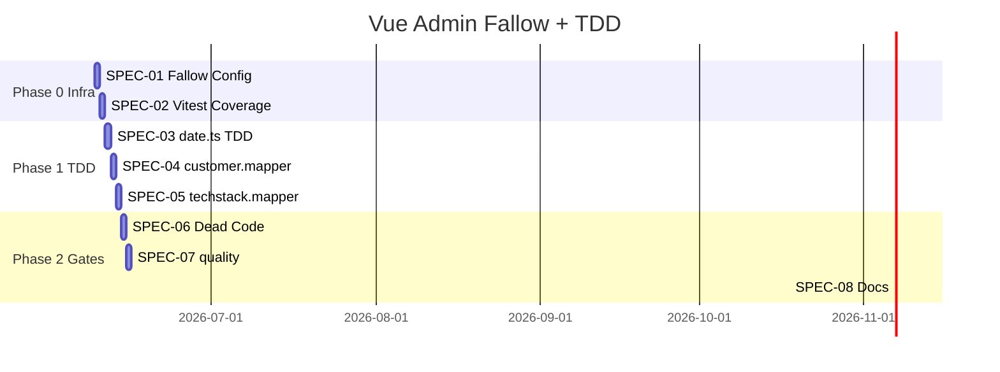

# Spec-Driven Plan: Fallow + Vitest (Vue Admin)

**Branch:** `feature/vue-admin-fallow-vitest`  
**Stand:** 2026-06-08  
**Methode:** TDD (Red → Green → Refactor) + Fallow + Vitest Coverage  
**Bezug:** Future Epic Q-08 aus [code-quality-improvements.md](./code-quality-improvements.md)

---

## 1. Ziel & Nicht-Ziele

### Ziel

- Vue Admin (`applications/backend`) mit **Fallow** absichern (dead-code, dupes, health)
- **Vitest Coverage** mit CI-Thresholds (analog Frontend-Epic)
- **TDD-Workflow** etablieren und an 2–3 Modulen praktisch ausprobieren
- `quality:ci` erweitern: Tests + Coverage + Fallow
- Keine funktionalen Regressionen (35 bestehende Tests grün, Cypress E2E unverändert)

### Nicht-Ziele

- Pinia → neues State-Design (Follow-up 11 bleibt separat)
- Vollständige Component-Test-Abdeckung aller `.vue`-Views
- Fallow für PHP/Python in diesem Epic
- Shared `api-error` mit Angular Frontend extrahieren
- Cypress-E2E-Umbau

---

## 2. Ausgangslage (Baseline 2026-06-08)

| Metrik | Ist |
|--------|-----|
| Vitest Spec-Dateien | 19 |
| Vitest Tests | **55** passed |
| Vitest Coverage | **konfiguriert** (Scope: utils/services/pinia/types; lines **75,7 %**, branches **67,0 %**) |
| Fallow | `dead-code` **0/0** (nach SPEC-06) |
| `quality:ci` | lint + type-check + `test:unit:ci` (Coverage) + `fallow:analyze` |
| Drone `vue-admin-quality` | wie `quality:ci` |

### Vitest — bestehende Specs

| Bereich | Specs |
|---------|-------|
| validation | customer, project, techstack |
| mappers | project, project-send, project-display, techstack-send |
| services | customer, projects, techstack |
| pinia | app, customers, projects, techstack |
| utils | api-error |
| components | TextInput |

### Ohne Unit-Tests (Kandidaten)

| Modul | Priorität | TDD-geeignet |
|-------|-----------|--------------|
| `utils/date.ts` | hoch | ✅ rein funktional |
| `utils/mappers/customer.mapper.ts` | hoch | ✅ rein funktional |
| `utils/mappers/techstack.mapper.ts` | hoch | ✅ rein funktional |
| `utils/mappers/customer-send.mapper.ts` | mittel | ✅ |
| `composables/formatDate.ts`, `formatIsoDate.ts` | mittel | ✅ (Re-exports von date) |
| `services/http-client.ts` | mittel | Integration-Mock |
| `types/index.ts` Barrel | niedrig | Fallow prüfen |
| `types/customer.ts` deprecated re-export | niedrig | Fallow dead-code |
| Views / Inputs (außer TextInput) | niedrig | später |

### Fallow-Sondereffekt (ohne Config)

Erster Lauf `npx fallow dead-code` ohne `.fallowrc.json` meldet u. a.:

- `customer.mapper.ts`, `techstack.mapper.ts` — teils **False Positives** (fehlende Entry-Points)
- `types/customer.ts` — deprecated Re-Export
- `utils/date.ts` — `parseDate` als unused export
- `@vue/eslint-config-prettier` — unused devDependency

→ **SPEC-01** zuerst: `.fallowrc.json` mit `main.ts`, `vitest.config.ts`, `src/**/*.spec.ts`, `cypress/**` als Entry.

### Fallow (nach SPEC-06, 2026-05-29)

`fallow dead-code` und `fallow dupes`: **0 Issues**. Health-Score: **98 A** (Gate: `--min-score 90`).

---

## 3. TDD-Workflow (für dieses Epic)

Jede inhaltliche Spec folgt **Red → Green → Refactor**:

```text
1. RED:    Failing Test schreiben (Vitest) — Verhalten präzise benennen
2. GREEN:  Minimalste Implementierung bis Test grün
3. REFACTOR: Duplikate/Names bereinigen — Tests müssen grün bleiben
4. FALLOW: dead-code nach größeren Refactors erneut prüfen
```

### Lokaler TDD-Loop

```bash
cd applications/backend
npm run test:unit          # Vitest watch — bleibt offen während Entwicklung
# In zweitem Terminal: Datei + Spec parallel bearbeiten
```

### TDD-Regeln (Epic)

| Regel | Beschreibung |
|-------|--------------|
| **Test zuerst** | Kein neues Export-Verhalten ohne vorherigen failing Test |
| **Ein Verhalten pro Test** | Ein `it()` = eine Erwartung / ein Branch |
| **Pure Functions zuerst** | `date.ts`, Mapper vor Stores/Services |
| **Kein Snapshot-Spam** | Nur für stabile, kleine Outputs |
| **Mock-Grenze** | HTTP nur an Service-Grenze (`vi.mock` axios), nicht in Mapper-Tests |

### Empfohlene TDD-Reihenfolge (Lernpfad)

1. `utils/date.ts` — `parseDate`, `formatDate`, `formatIsoDate`
2. `utils/mappers/customer.mapper.ts` — `normalizeCustomer`, `cloneCustomer`
3. `utils/mappers/techstack.mapper.ts` — `normalizeTechStack`, Select-Options
4. Optional: `DEFAULT_*` Error-Konstante (Parität zu Frontend `user-messages.ts`)

---

## 4. Specs

### SPEC-00: Baseline festhalten

**Akzeptanzkriterien:**

- [x] Plan-Branch `feature/vue-admin-fallow-vitest` angelegt
- [x] Baseline dokumentiert: 35 Tests, Coverage-Scope + Fallow-Baseline
- [x] `npm run test:unit:ci` grün vor jeder Phase

---

### SPEC-01: Fallow-Konfiguration (Vue Admin)

**Als** Maintainer  
**möchte ich** Fallow-Entry-Points wie beim Frontend  
**damit** dead-code zuverlässig ist.

**Akzeptanzkriterien:**

- [x] `applications/backend/.fallowrc.json` angelegt
- [x] Entry: `src/main.ts`, `vitest.config.ts`, `src/**/*.spec.ts`, `cypress/**/*.ts`
- [x] `duplicates.minOccurrences`: 3 (wie Frontend)
- [x] `npx fallow dead-code` — False Positives für `customer.mapper` / `techstack.mapper` beseitigt
- [x] NPM: `fallow:analyze` Script

**Vorlage Entry (Entwurf):**

```json
{
  "$schema": "https://raw.githubusercontent.com/fallow-rs/fallow/main/schema.json",
  "entry": [
    "src/main.ts",
    "vitest.config.ts",
    "src/**/*.spec.ts",
    "cypress/e2e/**/*.ts",
    "cypress.config.ts"
  ],
  "duplicates": { "minOccurrences": 3 },
  "health": { "ignore": ["**/*.vue", "**/*.spec.ts"] }
}
```

---

### SPEC-02: Vitest Coverage + Thresholds

**Als** CI  
**möchte ich** messbare Coverage mit Mindestschwellen  
**damit** TDD-Fortschritt sichtbar ist.

**Akzeptanzkriterien:**

- [x] `@vitest/coverage-v8` als devDependency
- [x] `vitest.config.ts`: `coverage` mit `provider: 'v8'`, Reporter `text`, `json`, `html`
- [x] `test:unit:ci` läuft mit `--coverage`
- [x] Start-Thresholds **konservativ** (Scope TS-Layer: lines/statements ≥ **65 %**, branches ≥ **55 %**, functions ≥ **55 %**)
- [x] Coverage-Output: `coverage/` (gitignored — bereits in `.gitignore`)

**TDD-Hinweis:** Thresholds erst nach SPEC-03/04 anheben — nicht vor erstem Green-Satz.

---

### SPEC-03: TDD — `utils/date.ts` (Lern-Spec)

**Als** Entwickler  
**möchte ich** Datums-Utils testgetrieben absichern  
**damit** TDD im Epic praktisch erprobt wird.

**Akzeptanzkriterien (TDD):**

- [x] **RED:** `date.spec.ts` mit Tests für `parseDate(null)`, invalid string, gültiges ISO
- [x] **RED:** Tests für `formatDate` / `formatIsoDate` de-DE bzw. `YYYY-MM-DD`
- [x] **GREEN:** Implementierung in `date.ts` erfüllt alle Tests (ggf. bereits vorhanden — Tests trotzdem explizit schreiben)
- [x] **REFACTOR:** Doppelte `parseDate`-Logik in Composables nur re-exportieren
- [x] Fallow: `parseDate` nicht mehr als dead export (wenn genutzt)

**Dateien:** `src/utils/date.ts`, `src/utils/date.spec.ts` (neu)

---

### SPEC-04: TDD — `customer.mapper.ts`

**Als** Entwickler  
**möchte ich** Customer-Normalisierung testgetrieben dokumentieren  
**damit** API-Null-Werte vorhersehbar sind.

**Akzeptanzkriterien (TDD):**

- [x] **RED:** Test `normalizeCustomer` mit fehlenden `id`/`name`/`location` → `''`
- [x] **RED:** Test `normalizeCustomers` für Arrays
- [x] **RED:** Test `cloneCustomer` erzeugt shallow copy
- [x] **GREEN:** Minimalcode; keine Verhaltensänderung gegenüber Ist ohne Tests
- [x] `customer.mapper.spec.ts` neu

---

### SPEC-05: TDD — `techstack.mapper.ts` (Auszug)

**Als** Entwickler  
**möchte ich** zentrale Tech-Stack-Mapper testen  
**damit** Store/Service-Regressionen seltener sind.

**Akzeptanzkriterien (TDD):**

- [x] **RED/GREEN:** Tests für `normalizeTechStack` / `normalizeTechStacks`
- [x] **RED/GREEN:** Test für `mapTechStackTypesToSelectOptions` (Pinia-Consumer)
- [x] `techstack.mapper.spec.ts` neu
- [x] Bestehende `techstack-send.mapper.spec.ts` bleibt grün

---

### SPEC-06: Dead Code & Deprecated Re-Exports (nach Fallow)

**Als** Maintainer  
**möchte ich** echte Leichen entfernen  
**damit** Fallow `dead-code` grün ist.

**Akzeptanzkriterien:**

- [x] `types/customer.ts` deprecated Re-Export: Consumer auf `@/utils/mappers/customer-send.mapper` umstellen, Re-Export entfernen
- [x] Ungenutzte Exports in Mappern bereinigen **oder** mit Spec abdecken (TDD bevorzugt)
- [x] `npx fallow dead-code` → 0 files, 0 types (nach SPEC-01)
- [x] `@vue/eslint-config-prettier`: in `.eslintrc.cjs` genutzt — `ignoreDependencies` in `.fallowrc.json`

**Reihenfolge:** Erst SPEC-03–05 (Tests), dann bereinigen — nicht blind löschen.

---

### SPEC-07: `quality:ci` + Drone-Parität

**Als** Contributor  
**möchte ich** einen Befehl für die volle Admin-Quality-Pipeline  
**damit** lokales Verhalten = CI.

**Akzeptanzkriterien:**

- [x] `package.json`: `fallow:analyze`, `test:unit:ci` mit Coverage
- [x] `quality:ci` = lint + type-check + test:unit:ci + fallow:analyze
- [x] Drone `vue-admin-quality` unverändert kompatibel (`npm run quality:ci`)
- [x] Root-`README.md` Quality-Gates-Tabelle um Fallow/Coverage ergänzt
- [x] `applications/backend/README.md` aktualisiert

---

### SPEC-08: Dokumentation & Wissen

**Akzeptanzkriterien:**

- [x] `.agent.example/skills/vue-admin-quality.md` (neu) oder Erweiterung `code-quality-fallow.md`
- [x] `code-quality-improvements.md` Q-08 → abgeschlossen verlinken
- [ ] Optional global: `.ai-brain/skills/vue.md` — Vitest + Fallow Abschnitt (Follow-up)

---

## 5. Umsetzungsreihenfolge



| Phase | Specs | Fokus | TDD? |
|-------|-------|-------|------|
| **0** | 01, 02 | Werkzeuge | Nein (Infrastruktur) |
| **1** | 03, 04, 05 | Pure Utils/Mapper | **Ja — Kern des Epics** |
| **2** | 06, 07, 08 | Gates + Docs | Teilweise (nur mit Test vor Delete) |

**PR-Strategie:** 1 PR `feature/vue-admin-fallow-vitest` (klein halten, TDD-Commits pro Spec)

---

## 6. Verification Checklist (Definition of Done)

```powershell
cd applications/backend
npm run lint:ci
npm run type-check:ci
npm run test:unit:ci          # mit Coverage
npx fallow dead-code
npx fallow dupes
npx fallow health --coverage coverage/coverage-final.json --min-score 90
npm run quality:ci
```

```powershell
# E2E unverändert grün (vor Merge)
npm run test:e2e:ci
```

**Erfolg:** Alle Befehle exit 0; Fallow dead-code 0/0; Coverage ≥ gesetzte Thresholds; mindestens **+15** neue Unit-Tests aus TDD-Specs 03–05.

**Verifiziert 2026-05-29:** `quality:ci` grün; `test:e2e:ci` — **6/6** Tests grün.

---

## 7. TDD-Beispiel (SPEC-03 — Vorlage)

```typescript
// date.spec.ts — RED zuerst schreiben
import { describe, expect, it } from 'vitest'
import { parseDate, formatIsoDate } from './date'

describe('parseDate', () => {
  it('returns null for invalid input', () => {
    expect(parseDate('not-a-date')).toBeNull()
  })

  it('parses ISO date strings', () => {
    expect(parseDate('2024-03-15')?.getFullYear()).toBe(2024)
  })
})

describe('formatIsoDate', () => {
  it('returns YYYY-MM-DD for valid dates', () => {
    expect(formatIsoDate('2024-03-15')).toBe('2024-03-15')
  })
})
```

Dann `npm run test:unit` — rot → `date.ts` anpassen → grün → refactor.

---

## 8. Risiken & Mitigation

| Risiko | Mitigation |
|--------|------------|
| Fallow False Positives ohne Entry | SPEC-01 zuerst |
| TDD zu langsam für große Views | Nur Utils/Mapper in Epic; Views explizit out of scope |
| Coverage-Threshold zu hoch zu früh | Baseline messen, dann schrittweise anheben |
| Cypress + Vitest Port-Konflikt | E2E separat in CI (bestehend) |

---

## 9. Referenzen

- Frontend-Vorbild: `applications/frontend/.fallowrc.json`, [code-quality-improvements.md](./code-quality-improvements.md)
- Vitest: `applications/backend/vitest.config.ts`
- Pinia-Architektur: `applications/backend/src/pinia/ARCHITECTURE.md`
- Global TDD: `.ai-brain/core/testing.md`, `.ai-brain/skills/branch-coverage-gaps.md`
